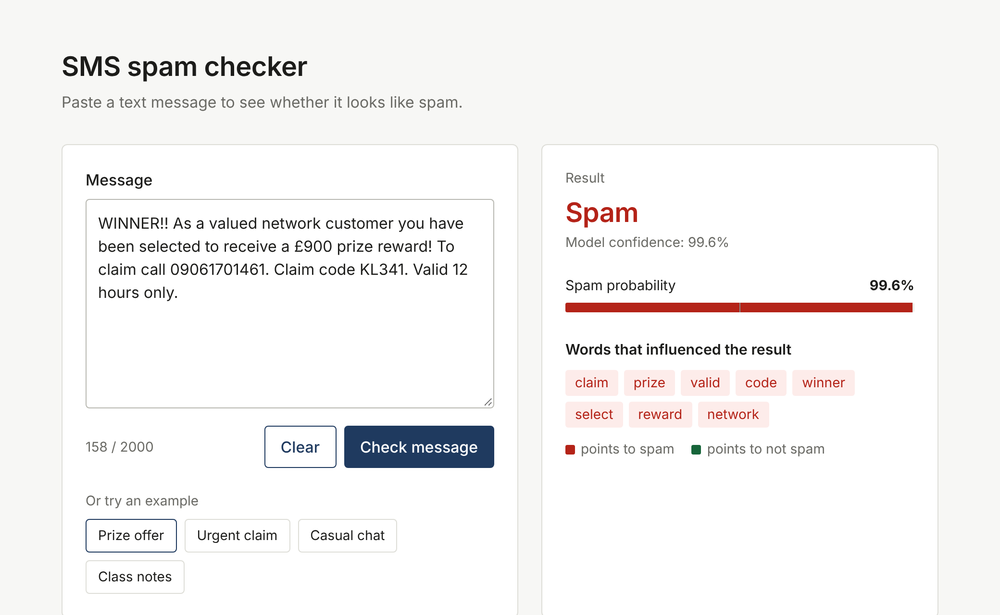

# SMS Spam Checker

A small web app that tells you whether a text message looks like spam. It uses a Naive Bayes classifier trained on the SMS Spam Collection dataset and is served with Flask.



## Features

- Classifies a message as **spam** or **not spam** and shows the spam probability
- Shows which words pushed the result towards spam or towards not spam
- Example messages to try with one click
- Works on desktop and mobile
- Trains itself automatically on first run, so there is nothing to download or configure

## How it works

1. **Preprocessing** (`preprocess.py`): lowercase the text, tokenize, remove stopwords and punctuation, apply Porter stemming.
2. **Features**: TF-IDF vectorizer with the 3,000 most frequent terms.
3. **Model**: Multinomial Naive Bayes (scikit-learn).
4. **Serving**: Flask exposes a `/predict` endpoint. The page sends the message there with `fetch` and renders the JSON response.

```
Browser (index.html + script.js)
   |  POST /predict  {"message": "..."}
   v
Flask (app.py) -> preprocess -> TF-IDF -> Naive Bayes
   |  JSON: label, probability, top words
   v
Browser shows the result
```

## Model performance

Evaluated on a held-out 20% test split (after removing duplicate messages).

| Metric    | Score |
|-----------|-------|
| Accuracy  | 97.2% |
| Precision | 100%  |

## Getting started

Requires Python 3.9 or newer.

```bash
# 1. Clone the repository
git clone https://github.com/<your-username>/<repo-name>.git
cd <repo-name>

# 2. (Optional) create a virtual environment
python -m venv venv
source venv/bin/activate        # Windows: venv\Scripts\activate

# 3. Install dependencies
pip install -r requirements.txt

# 4. Run the app
python app.py
```

Open <http://127.0.0.1:5000> in your browser.

The first run takes around 20 seconds because it trains the model and downloads the NLTK data (internet needed once). The trained model is saved as `.pkl` files and reused afterwards. It retrains automatically if your scikit-learn version changes.

To force a fresh training run:

```bash
python train.py
```

## API

`POST /predict`

Request:

```json
{ "message": "WINNER!! You have won a prize. Call now to claim." }
```

Response:

```json
{
  "label": "spam",
  "spam_probability": 96.84,
  "confidence": 96.84,
  "top_words": [{ "word": "prize", "weight": 1.868 }],
  "processed_text": "winner prize call claim"
}
```

Errors return `{"error": "..."}` with status 400 (empty or too long message, max 2000 characters) or 500.

## Project structure

```
.
├── app.py              # Flask app: routes and prediction logic
├── preprocess.py       # Text cleaning (stopwords, stemming)
├── model_utils.py      # Train, save and load the model
├── train.py            # Optional: retrain manually
├── spam.csv            # Dataset
├── requirements.txt
├── templates/
│   └── index.html      # Page markup
├── static/
│   ├── style.css       # Styles
│   └── script.js       # Calls /predict and renders the result
└── docs/
    └── screenshot.png
```

## Tech stack

Python, Flask, scikit-learn, pandas, NLTK, HTML, CSS and vanilla JavaScript.

## Dataset

[SMS Spam Collection](https://archive.ics.uci.edu/dataset/228/sms+spam+collection) (UCI Machine Learning Repository), 5,572 labelled messages before duplicates are removed.

## Limitations

- Trained only on English SMS messages from one dataset, so it may be less accurate on other languages, emails or newer scam styles.
- Intended as a learning project, not a production spam filter.

## License

Released under the MIT License. See [LICENSE](LICENSE).
